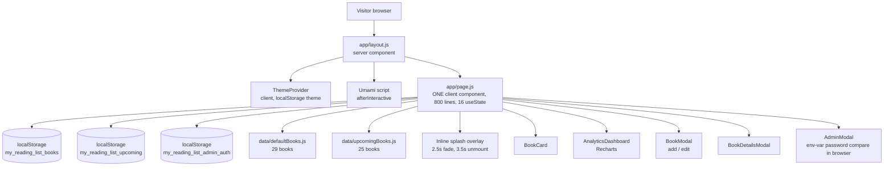
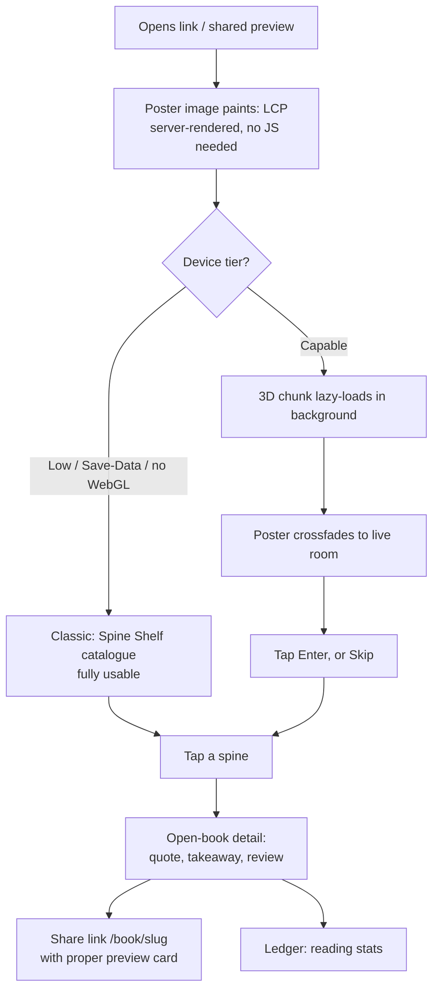
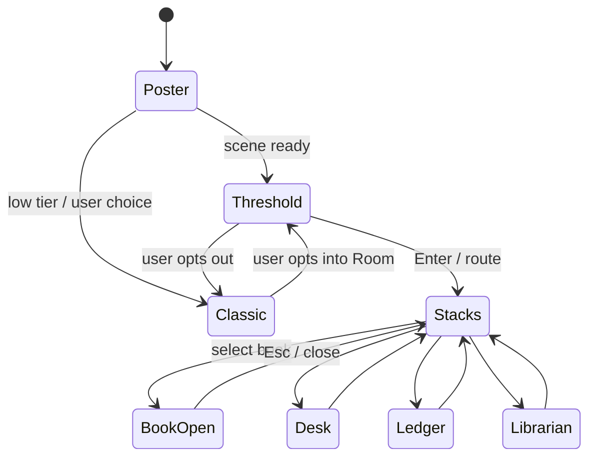

# ADVANCEPLAN — The Reading Room

**Project:** My Reading List (`roy-21/My-Reading-Book-List`)
**Plan type:** Analysis, design and planning only. No application code was modified.
**Verified against:** repository `master` @ `3aff4bd` (2026-10-11), cloned read-only, plus `PROJECT_REPORT.md` v1.0.0
**Plan date:** 2026-10-14
**Audience:** the project owner, and any engineer or coding agent implementing this plan

> **Read this first (for implementing agents).** The repo contains an `AGENTS.md` stating that this Next.js version has breaking changes and that the bundled docs in `node_modules/next/dist/docs/` must be read before writing code. Every Next.js API named in this plan (Cache Components / `use cache`, `proxy`, intercepting routes, `next/og`, `next/font/local`) must be **checked against those bundled docs for the installed version (16.2.7)** before use. Treat this plan's Next.js API names as intent, not as verified signatures.

**Priority legend used throughout**

| Tag | Meaning |
|---|---|
| **[MUST]** | Essential. The project is materially worse or unsafe without it. |
| **[SHOULD]** | High value, clearly achievable. Do after MUSTs. |
| **[COULD]** | Nice to have. Only if time remains. |
| **[EXPERIMENT]** | Ambitious, uncertain. Gated behind a spike and a go/no-go decision. |
| **[SKIP]** | Considered and rejected. See §19. |

**Contents:** [0 Evidence](#0-evidence-base-and-limitations) · [1 Summary](#1-executive-summary) · [2 Analysis](#2-deep-project-analysis) · [3 Vision](#3-vision-and-design-philosophy) · [4 Experience](#4-proposed-user-experience-and-user-journey) · [5 IA and navigation](#5-information-architecture-and-navigation) · [6 Visual design](#6-visual-design-system) · [7 3D environment](#7-the-3d-environment) · [8 Feature catalogue](#8-feature-catalogue) · [9 Architecture](#9-technical-architecture) · [10 Technology](#10-technology-recommendations) · [11 Assets](#11-asset-creation-plan) · [12 Performance and tiers](#12-performance-loading-and-experience-tiers) · [13 Accessibility and responsive](#13-accessibility-and-responsive-design) · [14 Security and maintainability](#14-security-maintainability-and-scalability) · [15 Testing](#15-testing-and-qa-strategy) · [16 Roadmap](#16-phased-implementation-roadmap) · [17 Risks](#17-risk-register) · [18 Budgets and completion criteria](#18-budgets-and-measurable-completion-criteria) · [19 Skip-list](#19-skip-list-considered-and-rejected) · [Appendices A–C](#appendix-a-open-questions-for-the-owner)

---

## 0. Evidence base and limitations

### 0.1 What was inspected

| Source | How it was used |
|---|---|
| `PROJECT_REPORT.md` (uploaded) | Read in full. Treated as a claim to verify, not as ground truth. |
| GitHub repo `roy-21/My-Reading-Book-List` | Cloned read-only into a scratch directory (public, unauthenticated). Read: `app/layout.js`, `app/page.js` (all 800 lines), `app/globals.css` (head + key rules), all 5 components + `ThemeProvider`, both data files, `package.json`, configs, `README.md`, `implementation_plan.md`, `AGENTS.md`, `.gitignore`, and the full 20-commit history. |
| Git history | Scanned for committed secrets and for the reasoning behind past design decisions. |

### 0.2 What could NOT be verified

These are stated limits. Nothing below was assumed to exist.

- **No running app.** The site was never built, run, profiled or screenshotted. Every performance, visual and runtime-behaviour statement is derived from reading code and is marked "to verify".
- **No deployment information.** Hosting provider, live URL, and current Umami data are unknown.
- **The owner's real data.** All edits the owner made through the admin UI live only in *their* browser's `localStorage`. They are not in the repo. See finding F-03; this affects migration.
- **Only 1 of 3 asset files.** `public/library_background.png` was measured, not viewed in context of the live page.
- **`globals.css`** was read through the token layer and class inventory (lines 1–140 plus grep of the rest), not line-by-line to the end.
- **Frameworks:** library behaviours cited from memory (React Three Fiber, drei, gltf-transform, Next 16 features) must be confirmed at install time. Where that matters it is flagged **"verify"**.

### 0.3 The report is partly out of date. Trust the code.

`PROJECT_REPORT.md` describes an earlier snapshot of the project. Several of its statements are contradicted by the repository at HEAD. A fuller table is in §2.4. The three that change decisions:

1. It says the shelf has **17 books**. The code has **29** (7 completed, 2 reading, **20 to-read**).
2. It says the **rating bar chart is not rendered**. It **is** rendered (`AnalyticsDashboard.js:186–209`).
3. It says modals have **accessible backdrops**. The code has **no ARIA roles, no Escape handling, no focus trap**, and the backdrop does not close the modal.

> **Security note on the report itself.** `PROJECT_REPORT.md` prints the admin username and password in plaintext (§2.1, §3.1, §4.2). Do **not** commit or publish that file as-is. Redact it first. See F-01 and F-23.

---

## 1. Executive summary

### 1.1 What the project is

A Next.js 16 / React 19 / Tailwind v4 single-page site that doubles as a **personal-branding portfolio** and a **personal reading tracker**. It shows 29 shelf books and 25 queued books, a quote spotlight, filters, a detail modal, a Recharts analytics view, a dark/light theme, Umami analytics, and a client-side "admin mode" for CRUD. All data lives in `localStorage`.

### 1.2 The most important observation

The owner has **already named this project a library.** The splash screen reads *"Welcome to Sojib's Virtual Library"* (`app/page.js:38`) over a library photograph. The ambition is not an add-on to the project; it is the project's own stated identity, currently expressed as a 2.5-second loading screen. This plan turns that sentence into the product.

### 1.3 Four facts that shape the whole plan

| # | Fact (verified) | Consequence for design |
|---|---|---|
| 1 | **67% of titles are Bengali** (36 of 54: 22/29 shelf, 14/25 upcoming). The only font is Outfit, which is Latin-only. `<html lang="en">` is global. | Bengali typography is a first-class design problem, not an edge case. It also decides how 3D book spines must be drawn (§7.4). |
| 2 | **Public visitors never see the owner's edits.** Data is per-browser `localStorage`. A recruiter sees the seed file, always. | A "portfolio" whose live data can't be updated is the project's biggest product flaw. A real data layer is a prerequisite, not a polish item. |
| 3 | **Server HTML is only a spinner.** The entire page is a client component gated on `isLoaded` (`page.js:247–257`). | No crawlable content, no meaningful social preview, slow perceived load. The immersive layer must be built on top of a server-rendered catalogue, not instead of one. |
| 4 | The owner's own git history shows a **deliberate move toward restraint**: "remove flashy gradients, simplify card layout, mute color palette" (`c7ada97`), then "pure dark theme, remove glassmorphism … minimal aesthetics" (`68f18f9`). | The immersive design must feel **calm, warm and literary**, not a tech demo. Taste signal from the owner's own commits. |

### 1.4 The recommendation in one paragraph

Build **"The Reading Room"**: one intimate, warmly lit private library with five stations (Threshold, Stacks, Reading Desk, Ledger, Librarian's Desk). It must be an **enhancement layer over a fast, accessible, server-rendered catalogue**, never a replacement. Ship it in this order: fix the foundation and give the site a real database and real auth; reskin the catalogue as a "Spine Shelf" with an open-book detail view (a large share of the library feeling with almost no WebGL risk); then run a **time-boxed 3D spike with a go/no-go gate** before committing to the full WebGL room. If the gate fails, Plan B (a 2.5D parallax library) still delivers the concept.

### 1.5 Top recommendations by priority

| Priority | Recommendation | Phase |
|---|---|---|
| **[MUST]** | **Rotate the admin password now.** It is a literal in public source (`page.js:180–181`) and in git history. | 0 |
| **[MUST]** | **Export the owner's `localStorage` data before touching persistence.** It exists nowhere else. | 0 |
| **[MUST]** | Replace client-only "admin" with **server-verified auth**; replace `localStorage` with a **Postgres database**. | 1 |
| **[MUST]** | Server-render the catalogue; add the missing `<h1>`, landmarks, real dialogs, keyboard access. | 1 |
| **[MUST]** | Self-host fonts including a **Bengali-capable family**; mark Bengali text `lang="bn"`. | 1–2 |
| **[MUST]** | Fix the data-integrity bugs (seed resurrection, ratings on unread books, start-vs-completed dates). | 1 |
| **[SHOULD]** | "Spine Shelf" catalogue + route-backed "open book" detail + replace splash with a skippable threshold. | 2 |
| **[SHOULD]** | The 3D Reading Room, as a lazy-loaded enhancement with a three-tier quality ladder. | 3 |
| **[COULD]** | Ambient audio, visitor recommendations, colophon. | 4 |
| **[EXPERIMENT]** | Free-walk navigation, physics, multiplayer. Not recommended (§19). | none |

---

## 2. Deep project analysis

### 2.1 Purpose, users and intent

- **Primary purpose** (from report §1, confirmed in code): a public personal-branding showcase for recruiters, collaborators and peers, demonstrating frontend/engineering competence and "data-driven literary insights".
- **Secondary purpose:** a private reading tracker the owner edits.
- **Users today:** (a) anonymous visitors, read-only, who only ever see seed data; (b) the owner, who can edit, but only on one device.
- **Intent signals in the repo:** the splash copy ("Virtual Library"), the library photograph, the owner's Umami question in `New Text Document.txt` (Bengali note asking how to count day/week/month/year visitors), and the deliberate styling retreat in git history.

### 2.2 Architecture as built (verified)



**Stack:** Next 16.2.7, React 19.2.4, Tailwind v4, lucide-react, Recharts 3.8, clsx, tailwind-merge. JavaScript only (`jsconfig.json`, no TypeScript). No tests, no CI, no backend, no `next/image`, no API routes.

### 2.3 Verified inventory (by evidence)

| Area | Status | Evidence |
|---|---|---|
| Book grid, search, genre/status filters | Implemented | `page.js:229–245, 585–609` |
| Detail modal | Implemented (accessibility gaps) | `BookDetailsModal.js` |
| Add / edit / delete / promote-from-upcoming | Implemented, client-only | `page.js:134–220` |
| Analytics: stats, donut, timeline, **rating bar** | **Implemented** (report says rating bar missing) | `AnalyticsDashboard.js:109–209` |
| Theme toggle, no-flash script | Implemented | `layout.js:24–39`, `ThemeProvider.js` |
| Splash screen | Implemented, fixed timing | `page.js:103–116, 266–312` |
| Quote spotlight | Implemented, re-randomises on every `books` change | `page.js:118–131` |
| Umami | Implemented, no custom events | `layout.js:45–51` |
| Export / print | **Not implemented** | no code; README roadmap item |
| Real cover images | **Not implemented** | CSS gradient presets only (6 in `BookModal.js:5–12`) |
| Database / server auth | **Not implemented** | |
| Tests / CI | **Not implemented** | |
| ARIA / keyboard handling / reduced motion / `next/image` | **None anywhere** | grep over `app/` and `components/` returns 0 matches |

### 2.4 Report versus repository

| # | `PROJECT_REPORT.md` says | Repository at HEAD shows | Impact |
|---|---|---|---|
| 1 | 17 shelf books, 42 total | **29** shelf + 25 upcoming = **54** | Scene must be sized for ~54, not 42 |
| 2 | Rating bar chart not rendered; "data computed only" | Rendered (`AnalyticsDashboard.js:186–209`) | Remove from remaining-work list |
| 3 | Modals have "accessible backdrops" | No `role`, no `aria-*`, no Escape, no focus trap, backdrop click does nothing | Real a11y work required |
| 4 | `.env.example` and `.env.local` exist | Neither is tracked; `.gitignore` excludes `.env*` | Env contract is undocumented |
| 5 | Credentials come from env vars | **Literal fallbacks are hard-coded in source** (`page.js:180–181`) | Credential is public regardless of env |
| 6 | "Role-based protection" | A boolean in `localStorage` (`page.js:94–97, 184`) | Not authorization |
| 7 | Timeline of "completed books by month" | Uses `startMonth/startYear`, i.e. **start** date | Mislabelled metric |
| 8 | "High-resolution library backdrop" | 1024×1024 **JPEG named `.png`**, 927 KB, shown at 20% brightness, via CSS background | Low-res, heavy, unoptimised |
| 9 | "Audited & Production-Verified" | No tests, no CI; deployment unknown | Claim not evidenced |
| 10 | Fonts "Complete" with fallbacks | Render-blocking Google CSS `@import`; Latin-only; Bengali falls back to system font | Typography unowned for majority content |

### 2.5 Findings register

Severity: **Critical** (act now), **High**, **Medium**, **Low**.

| ID | Sev | Finding | Evidence | Fix in |
|---|---|---|---|---|
| F-01 | **Critical** | Admin username and password are string literals in committed source, and `NEXT_PUBLIC_*` vars are bundled to every browser. The repo is public. | `page.js:180–181`; commit `3aff4bd`; `PROJECT_REPORT.md` | Phase 0 (rotate), 1 (remove) |
| F-02 | High | "Admin" is a UI flag. Setting `localStorage["my_reading_list_admin_auth"]="true"` unlocks it. Harmless today (only affects the visitor's own browser); **dangerous the moment a database exists**. | `page.js:94–97, 179–188` | 1 |
| F-03 | High | Data never reaches other visitors. Owner edits are invisible on the live site and unrecoverable if browser storage is cleared. | all `localStorage.setItem` calls | 0 (export), 1 |
| F-04 | High | **Deleting a seed book does not persist.** On next load, seed entries absent from storage are re-added by the "merge new defaults" logic. | `page.js:51–77` | 1 |
| F-05 | High | Server HTML is a spinner. No crawlable catalogue, no useful link preview. | `page.js:247–257` | 1 |
| F-06 | Medium | After the splash unmounts there is **no `<h1>`** on the page. No `<header>`/`<footer>` landmark semantics beyond `<nav>`/`<footer>`; the "brand" is a clickable `<div>`. | `page.js:37, 68` | 1 |
| F-07 | High | Dialogs: no `role="dialog"`, no `aria-modal`, no Escape, no focus trap or restore, backdrop click doesn't close, icon buttons have no accessible name. | `BookDetailsModal.js:16–45`; 0 `aria`/`role`/`keydown` matches repo-wide | 1 |
| F-08 | High | `BookCard` is a clickable `<div>` (not focusable). Admin edit/delete appear only on **hover** (`opacity-0 group-hover`), unreachable by touch or keyboard. | `BookCard.js:28–32, 82` | 1 |
| F-09 | Medium | No `prefers-reduced-motion` handling anywhere. Splash shows for a fixed 2.5 s on **every** page load regardless of readiness. | `page.js:103–116`; grep | 1–2 |
| F-10 | High | Fonts: render-blocking Google `@import`; Outfit has no Bengali glyphs; no `lang="bn"`. History shows `next/font/google` was abandoned for **build failures** (`1a3f752`). | `globals.css:1`; `layout.js:20` | 1–2 |
| F-11 | Medium | Splash image is a 1024² JPEG upscaled with `bg-cover`, not `next/image`, filtered to 20% brightness. | `page.js:17–23` | 2 |
| F-12 | Medium | Average rating is computed over **all** books including 20 "to-read" titles that carry seeded ratings of 4–5. Every one of the 29 ratings is 4 or 5, so the rating chart has two bars. | `page.js:261–263`; `AnalyticsDashboard.js:101–103`; seed data | 1 |
| F-13 | Medium | "Reading timeline" plots **start** month/year; 20 seeded books all start "June 2026". | `AnalyticsDashboard.js:86–98` | 1 |
| F-14 | Medium | Genre taxonomy is fragmented: 11 shelf genres mixing English and Bengali labels; the add/edit form offers 10 different English genres (no "Poetry", none of the Bengali ones). Donut has 8 colours for 11+ slices (colours repeat). | seed data; `BookModal.js:19–22`; `AnalyticsDashboard.js:9, 134` | 1 |
| F-15 | Medium | `page.js` is an 800-line monolith with 16 `useState`, 89 inline `style={{}}` objects (145 more in components) mixed with Tailwind classes and custom CSS classes. Three styling systems at once. | counts | 1 |
| F-16 | Low–Med | Token layer is brittle: Tailwind's `gray-*` scale is remapped per theme (so `text-gray-500` means different things in each theme), and `@theme` entries reference same-named variables. **Verify in browser.** | `globals.css:112–131` | 1–2 |
| F-17 | Low | New IDs are `Date.now().toString()` while seed IDs are `"1"…"29"`, `"up-1"…`. No stable slugs, so no shareable URLs. | `BookModal.js:64` | 1 |
| F-18 | Medium | No tests, no CI. | `package.json` | 1, 5 |
| F-19 | Low | Metadata: `authors` is set to the site name, not a person; no `metadataBase`, OG image, Twitter card or canonical; manual viewport meta; `theme-color` is fixed dark in light mode. | `layout.js:5–23` | 2 |
| F-20 | Low | Blocking native `confirm()` for delete and reset. | `page.js:166`; `BookDetailsModal.js:135` | 1 |
| F-21 | Low | README and report have drifted from the code. | §2.4 | 5 |
| F-22 | Info | Umami works but emits no custom events, so there is no data on which parts of the site visitors use. | `layout.js` | 2–3 |
| F-23 | High | `PROJECT_REPORT.md` prints the credential in plaintext. | report §2.1, §3.1, §4.2 | 0 |

### 2.6 What is genuinely good (preserve it)

- **The seed content is real and personal**: written reviews, takeaways and quotes for each book. This is the soul of the site and the thing worth building a room around.
- **The anti-flash theme script** is correct and should be kept as the single source of truth for light/dark.
- **Pure-logic seams already exist** in embryo: filtering, stats and timeline aggregation are plain functions waiting to be extracted and unit-tested.
- **Umami** is the right privacy-first choice and costs nothing to extend with events.
- **Recharts** is working and already themed; reuse it inside the immersive UI rather than rebuilding charts in 3D.
- **The owner's taste signals** (restraint, muted palette, indigo accent) are coherent. The redesign keeps indigo as the "bookplate ink" accent.

### 2.7 Architectural weaknesses, summarised

1. **No server.** Everything that matters (persistence, auth, SEO, sharing) needs one.
2. **One giant client component.** Prevents server rendering, URL state, code-splitting and testing.
3. **Domain model is implicit.** Two arrays with different shapes (`defaultBooks` vs `upcomingBooks`), a title-string match to "promote" a book (`page.js:147–154`), and a genre list derived from data.
4. **No design-system layer.** Buttons, badges, dialogs and form fields are re-implemented inline.

None of these block an immersive layer in principle, but **all of them would make a 3D layer fragile**, which is why Phase 1 precedes it.

---

## 3. Vision and design philosophy

### 3.1 Vision statement

> A private library you are invited into: quiet, warm, a little bilingual, and full of one person's actual opinions about books. The room is the interface; the books are the content.

### 3.2 Design principles (decision rules, in priority order)

1. **Content first, always reachable.** Every book, quote and review is available as plain server-rendered HTML. The 3D room is a *presentation* of that content, never the only way to reach it.
2. **Enhancement, not replacement.** Three experience tiers (§12.2): Classic, Lite, Full. A phone on a slow connection gets Classic and loses nothing important.
3. **One memorable moment, everything else quiet.** The memorable moment is *arriving*: the threshold, then pulling a book from a shelf and opening it. Everything else stays disciplined. This follows the owner's own commit history toward restraint.
4. **3D for orientation and delight; 2D for reading and forms.** Dense text, forms, charts and login are DOM. Never render a form or a paragraph in WebGL.
5. **Bilingual by construction.** Bengali is the majority language of the collection. Every typographic and texture decision is tested on real Bengali titles first.
6. **Procedural over modelled.** With 54 books and one maintainer, no per-book 3D modelling. Books are generated from data (§7.4).
7. **Earn every effect.** No effect ships unless it answers a user action, orients the user, or makes the library feel inhabited. Ambient motion is minimal and respects reduced-motion.
8. **Measure it.** Every tier decision and engagement claim is backed by a budget (§18) and Umami events (§8, FT-14).

### 3.3 Honest trade-off to acknowledge

A 3D room for ~54 books is **disproportionate if judged as a catalogue**. It is proportionate only if judged as a **portfolio piece and a brand statement**, which is what the project says it is (report §1.2). That is why the plan (a) keeps the catalogue excellent on its own, (b) gates the WebGL build behind a spike, and (c) defines a cheaper Plan B (§16, Phase 3).

---

## 4. Proposed user experience and user journey

### 4.1 The concept: a single private library, five stations

A small, intimate room (a personal study, not a cathedral) matching the scale of the collection. Five stations, each mapped to something that already exists in the app.

| Station | Real-world metaphor | Maps to existing feature | Primary interaction |
|---|---|---|---|
| **Threshold** | Entry arch and door | Splash screen + quote spotlight | "Enter"; quote of the day inscribed on a plaque |
| **The Stacks** | Wall of shelves in labelled bays | Book grid + search + genre/status filters | Hover/tap a bay, then a spine; filters dim non-matching spines |
| **Reading Desk** | Lamp, open book, stack of current reads | Books with `status = reading` | Click the open book to read the review spread |
| **The Ledger** | Brass-framed reading ledger on the wall | Analytics dashboard | Camera frames a DOM panel containing the Recharts charts |
| **Librarian's Desk** | Desk with a key and acquisition slips | Admin login, Add book, Upcoming queue | Opens DOM drawers; all forms stay 2D |

Where each book physically lives:

| Data state | Location in the room |
|---|---|
| `completed` | The Stacks, in its genre bay, spine out |
| `reading` | Reading Desk |
| `to-read` | A "waiting" shelf ledge at the end of each bay |
| `upcoming` (25 titles) | A trolley of new arrivals by the Librarian's Desk |

> **Note.** Today `to-read` (inside the shelf) and `upcoming` are two separate data structures. §9.5 proposes merging them into one `status` field, which also removes the fragile title-match used to "promote" a book (`page.js:147–154`).

### 4.2 User journeys

**Journey A: a recruiter, 60 seconds, probably on a phone**



**Journey B: a returning reader, desktop.** Skips the entrance (remembered per session), lands in the Stacks, filters to "Bengali fiction", hovers spines (labels in the correct script), opens one, reads the review.

**Journey C: the owner.** Opens the Librarian's Desk, signs in with a server-verified session, adds a book (form in a DOM drawer), and the new spine appears on the shelf for **all** visitors within seconds (cache revalidation, §9.6).

### 4.3 Entrance sequence (the single orchestrated moment)

1. Poster (an actual render of the room at its entrance framing) is already on screen at first paint.
2. When the 3D chunk is ready, the poster crossfades to the live scene, with a slow 3-second dolly toward the door. If the user acts, the dolly is cancelled.
3. The door opens; light spills; the camera settles at the Stacks.
4. **Shown once per session**, always skippable, and omitted entirely when reduced-motion is on or tier is Classic. This replaces the current fixed 2.5-second splash that blocks every page load (F-09).

---

## 5. Information architecture and navigation

### 5.1 Route map (target)

| Route | Purpose | Rendering |
|---|---|---|
| `/` | Threshold + default station | Server-rendered shell; room mounts client-side |
| `/stacks` | Shelf catalogue, filters via query params (`?genre=&status=&q=`) | Server-rendered list |
| `/desk` | Currently reading | Server-rendered |
| `/ledger` | Analytics | Server data, client charts |
| `/book/[slug]` | **Canonical book page**: SEO, share previews, deep link | Server-rendered + `generateMetadata` + OG image |
| `@modal/(.)book/[slug]` | Same page as an overlay when navigating from inside the room (intercepting route) | Parallel + intercepting route |
| `/admin` | Sign-in; admin UI | Server session required |
| `/export.json`, `/export.csv` | Data portability (closes the README "export" item) | Route handler |
| `/print` or `@media print` | Printable list | CSS |

**Why URL-driven stations:** deep links, back/forward button behaviour, shareable filtered views, analytics per station, and server rendering of the right content. Camera position becomes a *consequence of the route*, not separate hidden state.

### 5.2 Persistent navigation (always DOM, always keyboard reachable)

- Brand link (a real `<a>`), station list (Threshold, Stacks, Desk, Ledger), search (command palette, §8 FT-12), **Classic ↔ Room** toggle, **Day ↔ Night** (replaces the Sun/Moon button, same persistence key `theme`), **Sound** toggle (off by default), Librarian's Desk entry.
- A **"Skip to catalogue"** link is the first focusable element.

### 5.3 Station state machine



---

## 6. Visual design system

### 6.1 Palette ("night ink, walnut, lamp")

The page void stays the owner's existing `#0C0E14`, so the room feels like a lit space inside the same night. Indigo remains the **UI accent**, reinterpreted as *bookplate ink* (ribbons, focus rings, stamps). This avoids two common generic looks (cream-plus-terracotta, and black-plus-neon-accent).

| Token | Dark ("Night") | Light ("Day") | Role |
|---|---|---|---|
| `--void` | `#0C0E14` | `#F8FAFC` | Page background (existing values) |
| `--walnut-700` | `#3B2A20` | `#5A4030` | Shelving, desk |
| `--walnut-500` | `#6B4A33` | `#8A6444` | Wood highlight |
| `--oxblood` | `#4A1D26` | `#6B2B36` | Rug, leather spines |
| `--paper` | `#E9E2D0` | `#F3EEDF` | Book pages (inside the book only, not a page background) |
| `--lamp` | `#FFB454` | n/a | Warm emissive light |
| `--window` | `#8FA8D6` (moon) | `#EAF1FF` (sun) | Window light |
| `--ink` (accent) | `#818CF8` | `#4F46E5` | Interactive accent, ribbons, focus ring (existing indigo) |
| `--brass` | `#B8924A` | `#9A7633` | Plates, hardware |

**Genre spine colours.** The six existing cover-gradient presets (`Slate, Navy, Forest, Wine, Charcoal, Aubergine`) map **1:1** to spine colours through a lookup table, so every book keeps the colour the owner chose. See `deriveSpine()` in §7.4.

All text/background pairs must meet **WCAG 2.2 AA** (4.5:1 body, 3:1 large). The existing `--text-muted` (`#636D82` on `#0C0E14`) should be **re-measured**; it is a likely borderline case. **To verify.**

### 6.2 Typography

| Role | Candidate | Why |
|---|---|---|
| UI and body (both scripts) | **Anek Bangla** (variable) *or* **Hind Siliguri** | One family with credible Latin *and* Bengali so mixed UI never visibly switches font |
| Display, Bengali | **Noto Serif Bengali** | Literary tone for titles and quotes |
| Display, Latin | **Newsreader** | Editorial serif with optical sizes |
| Replaces | Outfit (Latin-only) | Outfit stays only if the owner wants it for Latin UI chrome |

These are **candidates**. Final choice is decided in a one-day type test in Phase 2 using the **real 36 Bengali titles** and checking conjunct rendering (যুক্তাক্ষর), line height and weight pairing.

Rules:
- Serif body copy gets slightly more line-height than sans. Keep measure under ~75 characters.
- **Avoid templated tells:** no all-caps tracked eyebrow labels above every heading, no single accented word in the headline (the current `My<Reading>List` gradient word and *"Sojib's Virtual Library"* gradient span are that pattern), no identical rounded cards everywhere.
- Bengali text gets `lang="bn"` on the element; the document stays `lang="en"`.
- **Self-host the fonts** (`next/font/local` with `.woff2` files, e.g. taken from the Fontsource npm packages). This is the fix for the owner's earlier build failures with `next/font/google` (`1a3f752`): it removes the build-time network fetch.

### 6.3 Spacing, radius, elevation

- 4-pt base scale; two radii only (`--r-sm: 6px` for chips and inputs, `--r-lg: 14px` for panels). Books are rectangular; reserve rounding for UI.
- Elevation expressed as light, not shadow stacks: panels are slightly luminous glass over the scene, not grey drop shadows.
- Replace the 234 inline `style={{}}` objects with tokens plus a small set of components (§9.3).

### 6.4 Materials and lighting (design intent; detail in §7.5)

| Element | Material intent |
|---|---|
| Shelving | Walnut, subtle grain, baked ambient occlusion |
| Book spines | Matte cloth/leather, slight edge wear, embossed title via texture |
| Brass plates | Low-roughness metal (reflective), only where the camera lingers |
| Floor | Dark boards plus an oxblood rug |
| Windows | Emissive glow card plus fake light shafts (cheap cone, additive) |

### 6.5 Motion language

| Kind | Duration / easing | Notes |
|---|---|---|
| Camera dolly between stations | 1.2–1.8 s, ease-in-out | Interruptible; cut to crossfade under reduced-motion |
| Book hover (slide out 2–3 cm, tilt 3°) | 180 ms, spring | Answers pointer; no idle motion |
| Book pull and open | 600–900 ms | The one theatrical beat |
| Panel open/close | 200–240 ms | Opacity and small translate only |
| Ambient (dust motes, lamp breathing) | very slow, tiny | **Off** under reduced-motion and Lite tier |

**No** scroll-hijacking, no auto-rotating objects, no per-section fade-and-slide-up entrances on every card.

---

## 7. The 3D environment

> **Scope note.** §7 is design intent plus the technical constraints that make it buildable. Implementation detail lives in §9 and §12. Everything here sits behind the spike gate in §16 (Phase 3).

### 7.1 The room

An intimate private library, about 9 m × 6 m with a 3.2 m ceiling. It is deliberately **a study, not a cathedral**: the collection is 54 books, and a vast hall would look empty and would waste GPU budget on architecture nobody inspects.

```
                           N  (windows, tall arches: day/night light enters here)
        ┌────────────────────────────────────────────────────────────┐
        │  LEDGER wall            │   THE STACKS (labelled bays)       │
        │  brass-framed panel     │  ┌────┬────┬────┬────┬────┬─────┐ │
        │  (DOM chart panel)      │  │Tech│Fict│Phil│Self│ Bn │Misc │ │
        │                         │  └────┴────┴────┴────┴────┴─────┘ │
        │                         │     rolling ladder, waiting ledge  │
  W     ├─────────────────────────┴────────────────────────────────────┤  E
        │  READING DESK                       │  LIBRARIAN'S DESK      │
        │  lamp, open book, current reads     │  key, slips, trolley   │
        │                                     │  of new arrivals       │
        ├─────────────────────────────────────┴────────────────────────┤
        │  THRESHOLD: door, brass quote plaque, rug                    │
        └────────────────────────────────────────────────────────────┘
                           S  (camera begins outside the door)
```

Stations map to existing features exactly as defined in §4.1. The layout is a **rail with five stops**, not an open floor.

> **Genre bays must be data-driven but capped.** The seed has 11 distinct genre strings mixing English and Bengali (F-14). After taxonomy normalisation (FT-03) the room has at most **6 bays** (5 named + "Miscellany"). Adding a 7th genre in the admin UI must not break the room.

### 7.2 Camera and navigation

| Mechanism | Behaviour | Why |
|---|---|---|
| **Station rail** | 5 waypoints `{position, target, fov}`. Moving between them is a 1.2–1.8 s eased dolly. Interruptible. | Predictable, accessible, and works with a single finger. |
| **Route-driven** | The URL decides the station (`/stacks`, `/desk`, `/ledger`). Camera is a *consequence* of route. | Deep links, back/forward, analytics, SSR of the matching content. |
| **Click/tap to focus** | Click a bay: camera frames the bay. Click a spine: opens the book (FT-13). | Direct manipulation without free-roam. |
| **Pointer parallax** | ±2° yaw/pitch following the pointer, damped. Off on touch and under reduced-motion. | Cheap depth cue. This is the main "it's a real space" signal. |
| **Keyboard** | `←/→` previous/next station, `↑/↓` bay row, `Enter` open, `Esc` back, `/` or `Ctrl/Cmd+K` command palette. | See §13. |
| **Scroll wheel** | **Does nothing to the camera.** The page does not hijack scrolling. | Avoids the most common immersive-site complaint. |

Free-walk (WASD, pointer lock) is **[SKIP]** (§19): disorienting, hostile to keyboard and screen-reader users, and unusable on touch.

### 7.3 Interaction specification

| Event | Response | Notes |
|---|---|---|
| Hover / keyboard focus on a spine | Slides out 2–3 cm, tilts about 3°, label brightens, DOM tooltip shows title and author | 180 ms spring. Focus uses the same visual plus a DOM focus ring on the list item. |
| Filter or search active | Non-matching spines dim to about 25% and recede 1 cm; matches get a brass edge glow | **Meaning-carrying interaction:** the shelf *is* the filter result. Camera glides to the first match. |
| Select a book | Slides out, lifts, arcs to the lectern, opens; a DOM panel (quote, takeaway, review) fades in beside it | 600–900 ms. The one theatrical beat. Route becomes `/book/[slug]` (FT-09). |
| `status = reading` | Open book on the desk, lamp lit, bookmark ribbon visible | Static, no idle motion. |
| Theme toggle | Window colour, lamp intensity and environment lerp over about 1 s | FT-15. Same `theme` key as today. |
| Admin promotes an upcoming book | Book moves from trolley to its shelf slot | Admin-only, only reachable from the DOM drawer. |
| Touch | **First tap** frames the bay, **second tap** selects the spine. Hit proxies are invisible boxes ≥ 44 CSS px when projected. | Spines are about 3 cm wide: raw hit-testing would be unusable on a phone. |

### 7.4 Procedural books: `deriveSpine()`

With 54 books and one maintainer, **no per-book 3D modelling** (principle 6). Each spine is generated from the data, **deterministically**, so the room is identical on every load and for every visitor.

**Inputs available today:** `title`, `author`, `genre`, `status`, `rating`, `coverGradient` (one of six presets, `BookModal.js:5–12`), `startYear/startMonth`.

**Derivation rules**

| Visual property | Derived from | Rule |
|---|---|---|
| Spine colour | `coverGradient` | 1:1 lookup so every book keeps the colour the owner chose. **Lift luminance** (see warning). |
| Width, height, depth, lean | stable hash of `slug` (fallback `id`) | Seeded PRNG, ranges in code sketch. Never `Math.random()`. |
| Title text | `title`, script detected from Unicode range | Drawn via **2D canvas** so the browser's text shaper handles Bengali conjuncts. |
| Foil colour | `genre` bay | Brass / paper / oxblood foil. |
| Rating pips | `rating`, **only when `status = completed`** | 1–5 small brass dots near the base. Avoids implying a rating for unread books (F-12). |
| Ribbon | `status = reading` | Short bookmark ribbon hanging from the top. |

> **Warning: all six presets are near-black** (`neutral-800/900`, `slate-900` to `*-950`). Dark spines in a dark room will read as a single black mass. Mitigations, in order of preference: (1) lift spine lightness by a fixed factor in 3D only; (2) foil-stamped titles in brass or paper colour; (3) a low warm rim light along the shelf front. **To verify in the greybox spike** before any asset work.

> **Warning: Bengali text in WebGL.** Most WebGL text libraries (SDF/MSDF atlases, `troika-three-text`) do **not** reliably shape Bengali conjuncts (যুক্তাক্ষর). **Do not draw titles with a WebGL text library.** Draw to a 2D canvas, upload as a texture. **Wait for the font** (`document.fonts.load(...)`) before drawing, or labels will render in a fallback font.

```js
// lib/room/deriveSpine.js — pure, deterministic, no WebGL, unit-testable.
// (Illustrative sketch. Types/Zod per §9.5. Tailwind v4 colour values must be read from the real tokens.)
const SPINE_COLORS = {
  "from-neutral-800 to-neutral-900": "#3b3b40", // Slate     (lifted for 3D)
  "from-slate-900 to-blue-950":      "#1f3a6b", // Navy
  "from-slate-900 to-emerald-950":   "#1d4d3c", // Forest
  "from-slate-900 to-rose-950":      "#6b2234", // Wine
  "from-neutral-900 to-neutral-950": "#2a2a2e", // Charcoal
  "from-slate-900 to-purple-950":    "#4a2a6b", // Aubergine
};

export function hash32(str) {              // FNV-1a
  let h = 2166136261;
  for (let i = 0; i < str.length; i++) h = Math.imul(h ^ str.charCodeAt(i), 16777619);
  return h >>> 0;
}
export function mulberry32(a) {
  return () => { a |= 0; a = (a + 0x6d2b79f5) | 0;
    let t = Math.imul(a ^ (a >>> 15), 1 | a);
    t = (t + Math.imul(t ^ (t >>> 7), 61 | t)) ^ t;
    return ((t ^ (t >>> 14)) >>> 0) / 4294967296; };
}
const hasBengali = (s) => /[\u0980-\u09FF]/.test(s);

export function deriveSpine(book) {
  const rnd = mulberry32(hash32(book.slug ?? book.id));
  return {
    id: book.id,
    width:  0.028 + rnd() * 0.022,   // metres
    height: 0.205 + rnd() * 0.085,
    depth:  0.150 + rnd() * 0.040,
    lean:   rnd() < 0.06 ? (rnd() - 0.5) * 0.12 : 0,   // rare, deterministic
    color:  SPINE_COLORS[book.coverGradient] ?? "#3b3b40",
    script: hasBengali(book.title) ? "bn" : "en",
    ribbon: book.status === "reading",
    pips:   book.status === "completed" ? book.rating : 0,
  };
}
```

**Layout** is a second pure function, `layoutBays(spines, bays)`: group by normalised genre key, order completed books by *completion* date (FT-03), pack left to right within a bay, spill to "Miscellany" past the bay cap. Because it is pure, it is tested without a GPU: no overlaps, stable order, handles 0 to 500 books.

**Draw-call strategy**

| Object | Technique | Why |
|---|---|---|
| The 54 real books | Individual meshes (or one mesh per bay), one label texture each from a **shared atlas** | Needed for per-book hover/selection. At this count it is cheap. |
| **Filler books** (decorative, non-interactive) | `InstancedMesh`, 2 to 3 draw calls total | **54 real books cannot fill a library.** Without filler the shelves look sparse. Real books carry a subtle brass edge so they read as "the owner's". |
| Architecture, furniture | Merged static meshes with **baked** lighting | The cheapest realistic look. |

> **Do not instance the real books until measured.** At 54 interactive objects, premature instancing adds per-instance picking complexity for no gain. Revisit if the collection exceeds about 150 books.

### 7.5 Materials and lighting

| Element | Material | Notes |
|---|---|---|
| Shelving, desk | Walnut. Baked ambient occlusion in a lightmap, 1k albedo + normal | Grain visible only where the camera lingers. |
| Spines | Matte cloth. `roughness ≈ 0.85`, no normal map | Texture from the label atlas. |
| Foil, plates, lamp hardware | Brass. Metalness ≈ 0.9, roughness ≈ 0.35 | Needs an environment map to read as metal. Use sparingly. |
| Floor and rug | Dark boards, oxblood rug | Rug hides the floor's contact seams. |
| Windows | Emissive card plus fake light shafts (additive cone, low alpha) | No real volumetrics ([SKIP]). |
| Page paper | Warm off-white | Appears only inside the open book. |

**Lighting policy**

| Aspect | Policy |
|---|---|
| Base | **Baked** lighting and AO for architecture (Blender bake). Real-time lights limited to 1 key spot on the focused book, 1 desk lamp point light, 1 hemisphere light. |
| Shadows | **Full tier:** pre-baked contact shadows; at most one real-time shadow caster. **Lite tier:** none. |
| Environment | One small local HDRI (1k), **self-hosted** (no CDN). Provides brass reflections. |
| Fog | Low-density warm `FogExp2`. Hides far geometry and helps depth. |
| Particles | A few hundred dust motes, **Full tier only**, off under reduced-motion. |
| Post-processing | **None by default.** Optional subtle bloom on lamps and a vignette on Full tier only. DoF only during the book-open beat and only as [EXPERIMENT]. |

**Day and Night presets** (FT-15). The existing Sun/Moon button becomes the lighting switch and keeps the `theme` localStorage key and the anti-flash script as the source of truth.

| Parameter | Night (dark theme) | Day (light theme) |
|---|---|---|
| Window light | cool moon `--window` | warm sun `--window` |
| Lamp intensity | 1.0 | 0.35 |
| Key spot | warm, focused | soft white |
| Fog colour | near `--void` | pale warm grey |
| Exposure | lower | slightly higher |

The scene reads the theme from the **store** (not React context: context does not cross into the R3F reconciler; see §9.2).

### 7.6 Sound

[COULD] (FT-19). **Off by default, never autoplays.** A visible toggle in the persistent nav (`aria-pressed`) and the choice is remembered. Three sounds only: low room tone loop, soft page turn on book open, wood slide on spine pull. Total budget ≤ 400 KB, loaded lazily on first enable, from licence-verified sources (§11).

### 7.7 Responsive behaviour of the room

| Viewport | Behaviour |
|---|---|
| Desktop ≥ 1024 px | Full rail, pointer parallax, hover states. Default tier by detection (§12.2). |
| Tablet | Same rail, no hover. Two-tap selection. Default **Lite** unless GPU tier is high. |
| Phone portrait | **Default Classic**, "Enter the Room" offered. If entered: **Lite**, camera frames **one bay at a time**, swipe between bays, large hit proxies. |
| Phone landscape | As tablet. |

### 7.8 What the 3D layer deliberately does not do

- It never **renders paragraphs, forms or charts** in WebGL. Reviews, the admin forms, login and Recharts remain DOM (principle 4).
- It never **gates** content. Every book is reachable without WebGL (principle 1).
- It never **moves on its own** except the one-time entrance (§4.3) and tiny, pausable ambient effects.
- It never plays **sound** unless the visitor asks.
