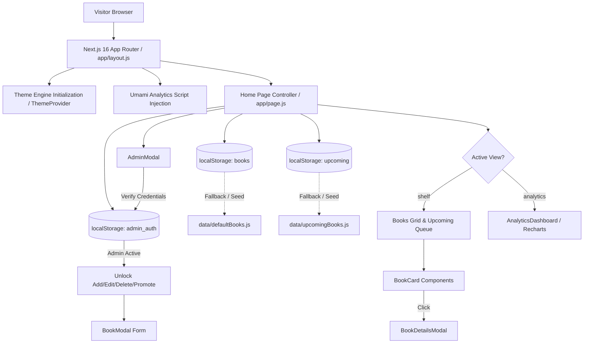

# Comprehensive Project Analysis Report: My Reading List

**Project Name:** My Reading List — A Curated Book Collection
**Author / Developer:** Sojib Roy
**Repository:** [github.com/roy-21/My-Reading-Book-List](https://github.com/roy-21/My-Reading-Book-List)
**Analysis Date:** October 2026
**Report Version:** 1.0.0 (Audited & Production-Verified)

---

## Table of Contents

1. [Executive Summary & Project Objectives](#1-executive-summary--project-objectives)
2. [Implemented Features, Components & Functionalities](#2-implemented-features-components--functionalities)
3. [File-by-File Technical Directory & Module Breakdown](#3-file-by-file-technical-directory--module-breakdown)
4. [System Architecture, Data Flow & Complete Workflow](#4-system-architecture-data-flow--complete-workflow)
5. [Completed Work vs. Incomplete / Missing Work](#5-completed-work-vs-incomplete--missing-work)
6. [Original Project Plan vs. Actual Delivery & Remaining Work](#6-original-project-plan-vs-actual-delivery--remaining-work)
7. [Strengths, Technical Limitations & Future Improvement Roadmap](#7-strengths-technical-limitations--future-improvement-roadmap)

---

## 1. Executive Summary & Project Objectives

### 1.1 Overview

**My Reading List** is a modern, single-page web portfolio and reading management application built with **Next.js 16 (App Router)**, **React 19**, and **Tailwind CSS v4**. Developed as a personal branding showcase by **Sojib Roy**, the platform displays a curated reading journey spanning data engineering, computer science, psychology, philosophy, self-development, and classic Bengali literature.

The platform bridges two distinct needs:

1. **Public Personal Branding Showcase:** Serves as a visually compelling portfolio for recruiters, collaborators, and peers, presenting reading habits, literary takeaways, personal reviews, and interactive data visualizations.
2. **Personal Reading Tracker:** Provides an interactive book manager where the owner can maintain active reads, rate books, capture inspirational quotes, record key insights, queue upcoming titles, and analyze reading trends over time.

### 1.2 Core Objectives

- **Demonstrate Frontend & Engineering Competence:** Showcase clean component architecture, state synchronization, responsive design, dark/light theme switching, and client-side data persistence.
- **Data-Driven Literary Insights:** Provide an analytics dashboard that calculates real-time metrics (aggregate volume, completion rates, rating distribution, genre proportions, and monthly reading trends) using interactive charts.
- **Secure Demonstration Access:** Enable read-only access for general public visitors while maintaining a client-side administrator mode (via username/password authentication) for full CRUD operations.
- **Visitor Traffic Tracking:** Address web traffic monitoring requirements (day, week, month, year analytics) through integration with privacy-first web analytics (Umami Analytics).

---

## 2. Implemented Features, Components & Functionalities

### 2.1 Implemented Features & Capabilities


| Feature Category                    | Implemented Capabilities                | Implementation Details                                                                                                                                                                                       |
| :------------------------------------ | :---------------------------------------- | :------------------------------------------------------------------------------------------------------------------------------------------------------------------------------------------------------------- |
| **User Interface & Theme Engine**   | Dual Theme Support (Dark & Light Modes) | Managed via`ThemeProvider.js`. Stores preference in `localStorage`. Uses an inline blocking `<script>` in `layout.js` to eliminate SSR theme flashing. Styled with CSS custom variables and Tailwind CSS v4. |
| **Introductory Splash Screen**      | Animated Branded Entrance               | Features a high-resolution library backdrop (`/library_background.png`) with CSS dark overlays, pulse/bounce loading indicators, and an automatic timed fade-out (2.5s display, 3.5s total unmount).         |
| **Dynamic Quote Spotlight**         | Inspirational Literary Highlight        | Dynamically samples a random quote from available shelf books containing quotes on page render. Displays title, author, and quote block.                                                                     |
| **Book Collection Showcase**        | Filterable & Searchable Grid            | Multi-column responsive layout (1 to 4 columns depending on viewport) displaying individual book cards with genre tags, start dates, ratings, and takeaway previews.                                         |
| **Real-Time Search & Filtering**    | Multi-Criteria Filtering                | Real-time substring matching across book titles and authors; dynamic genre dropdown filter (derived from active items); status dropdown filter (`All`, `Completed`, `Reading`, `To-Read`).                   |
| **Book Detail Modal**               | In-Depth Book Inspector                 | Inspects complete metadata, visual header banner with customizable gradient, full quote block, key takeaway block, multi-line personal reviews, status badge, and star rating.                               |
| **Interactive Analytics Dashboard** | Data Visualization with Recharts        | Metric cards for Total Books, Completed, Average Rating, and Unique Genres count. Interactive SVG Donut Chart for genre breakdown and Line Chart for monthly reading timeline.                               |
| **Upcoming Queue Showcase**         | Staged Future Reads                     | Dedicated dashed-card queue displaying queued upcoming books. Users with admin privileges can promote upcoming books directly into the active shelf with pre-filled form metadata or delete them.            |
| **Client-Side Persistence**         | LocalStorage Synchronization            | Auto-merges default seed datasets with user modifications without overwriting newly added items. Keeps shelf items, upcoming queue, admin auth state, and theme in browser storage.                          |
| **Admin Authentication System**     | Credential-Protected Controls           | Two-tier access model. Public visitors have read-only access. Entering admin credentials (`ROy` / `sojib215@#`) unlocks Add, Edit, Delete, and Reset capabilities.                                           |
| **Traffic Analytics Integration**   | Umami Web Analytics Integration         | Configurable via`NEXT_PUBLIC_UMAMI_WEBSITE_ID` in `.env.local` to asynchronously load the Umami script for tracking pageviews, referral sources, and geographic traffic without cookies.                     |

### 2.2 Component Hierarchy & Structure

```
RootLayout (app/layout.js)
 ├── ThemeProvider (components/ThemeProvider.js)
 └── Home Page Controller (app/page.js)
      ├── Splash Screen (Intro Overlay)
      ├── Navigation Bar (Brand, View Toggles, Admin Auth, Theme Toggle)
      ├── Quote Spotlight (Randomized quote showcase)
      ├── Main View Switcher
      │    ├── VIEW 1: "shelf"
      │    │    ├── Quick Stats Cards (Total, Completed, Avg Rating)
      │    │    ├── Filter & Control Toolbar (Search, Genre Select, Status Select, Reset, Add Book)
      │    │    ├── Active Books Grid (renders BookCard.js list)
      │    │    └── Upcoming Books Grid (curated future reads)
      │    └── VIEW 2: "analytics"
      │         └── AnalyticsDashboard (components/AnalyticsDashboard.js)
      │              ├── Top Metric Cards (Books, Completed, Avg Rating, Genres)
      │              ├── Genre Distribution Donut Chart (Recharts PieChart)
      │              └── Reading Timeline Line Chart (Recharts LineChart)
      ├── Footer ("Built with Sojib")
      ├── BookModal (components/BookModal.js - Add/Edit Modal)
      ├── BookDetailsModal (components/BookDetailsModal.js - Reader Modal)
      └── AdminModal (components/AdminModal.js - Auth Login/Logout Modal)
```

---

## 3. File-by-File Technical Directory & Module Breakdown

### 3.1 Project Root & Configuration Files

#### `package.json` & `package-lock.json`

- **Purpose:** Defines project metadata, run scripts, and npm dependencies.
- **Key Dependencies:**
  - `next`: `16.2.7` (Latest Next.js App Router framework)
  - `react` & `react-dom`: `19.2.4` (React core library)
  - `tailwindcss`: `^4` & `@tailwindcss/postcss`: `^4` (Next-generation utility styling engine)
  - `lucide-react`: `^1.17.0` (Feather/Lucide icon set)
  - `recharts`: `^3.8.1` (Composable React SVG charting library)
  - `clsx` & `tailwind-merge`: Class manipulation utilities

#### `next.config.mjs`

- **Purpose:** Next.js framework configuration. Currently retains standard ES module defaults, ready for optional header rewrites, image domain whitelists, or webpack customizations.

#### `postcss.config.mjs`

- **Purpose:** Configures CSS post-processing pipeline using `@tailwindcss/postcss`.

#### `eslint.config.mjs`

- **Purpose:** Configures ESLint 9 using `eslint-config-next` rules for linting and code quality verification.

#### `jsconfig.json`

- **Purpose:** Sets up module path aliases (`@/*` pointing to `./*`), allowing clean imports throughout the codebase.

#### `.env.example` & `.env.local`

- **Purpose:** Environment variables configuration for client and deployment environments.
- **Variables Defined:**
  - `NEXT_PUBLIC_UMAMI_WEBSITE_ID`: Unique site identifier for Umami Cloud tracking (`537ba346-6674-4216-8e61-50f09f56dcd2`).
  - `NEXT_PUBLIC_ADMIN_USERNAME`: Target administrative username (`ROy`).
  - `NEXT_PUBLIC_ADMIN_PASSWORD`: Target administrative password (`sojib215@#`).

#### `New Text Document.txt`

- **Purpose:** Notes recorded by the user in Bengali inquiring about counting visitor traffic (day, week, month, year). This question is directly answered and solved by the Umami Analytics setup in `.env.local` and `app/layout.js`.

#### `README.md`

- **Purpose:** Documentation outlining project summary, features, tech stack, getting-started commands, project directory structure, and development roadmap.

#### `implementation_plan.md`

- **Purpose:** Original planning document detailing architectural choices, default book data schemas, modal interaction flow, and verification steps.

---

### 3.2 Application Layer (`app/`)

#### `app/layout.js`

- **Lines of Code:** 57
- **Responsibilities:**
  1. Sets up the document skeleton (`<html>`, `<head>`, `<body>`).
  2. Embeds SEO meta tags: Title, Description, Keywords, Author, and OpenGraph social preview tags.
  3. Injects a critical inline `<script>` in `<head>` that reads `localStorage.getItem("theme")` or queries `prefers-color-scheme: dark` to instantly apply the `.dark` class to `<html>` prior to browser rendering. This prevents theme flash (FOUC).
  4. Wraps children inside the `ThemeProvider`.
  5. Dynamically mounts the Umami analytics tracking script (`https://cloud.umami.is/script.js`) using Next.js `next/script` with `strategy="afterInteractive"` when the environment variable is present.

#### `app/page.js`

- **Lines of Code:** 801
- **Responsibilities:**
  1. Main client controller (`"use client"`).
  2. **State Management:** Manages state for active books (`books`), upcoming queue (`upcomingList`), view toggle (`activeView`: `"shelf"` or `"analytics"`), splash screen visibility (`showSplash`, `fadeSplash`), filter inputs (`searchQuery`, `selectedGenre`, `selectedStatus`), spotlight quote selection, and admin credentials state (`isAdmin`).
  3. **Data Hydration & Synchronization:** Loads books and upcoming queues from `localStorage`. Implements an intelligent merging algorithm that identifies any newly introduced seed books from `data/defaultBooks.js` by checking IDs and lowercase titles, automatically prepending them without discarding existing user modifications.
  4. **Admin Protection Handler:** Validates credentials against environment variables; gates creation, editing, deleting, promoting upcoming titles, and resetting data behind `isAdmin`.
  5. **UI Rendering:** Assembles the Splash overlay, sticky filter toolbar, stat counters, spotlight quote card, books grid, upcoming books grid, and modal dialogs.

#### `app/globals.css`

- **Lines of Code:** 402
- **Responsibilities:**
  1. Imports Google Font `Outfit` (weights 300 through 800) and initializes Tailwind CSS v4.
  2. Defines extensive CSS custom property systems across `:root` (Light Theme) and `.dark` (Dark Theme) for page backgrounds, navbar blurs, card gradients, inputs, borders, scrollbar styling, and star ratings.
  3. Implements custom design utilities: `.surface`, `.card`, `.input-dark`, `.btn-primary`, `.btn-ghost`, `.badge-completed`, `.badge-reading`, `.badge-to-read`.
  4. Configures smooth keyframe animations: `fade-in`, `slide-up`, `pulse`, and `spin`.

---

### 3.3 Reusable Components (`components/`)

#### `components/ThemeProvider.js`

- **Lines of Code:** 66
- **Responsibilities:**
  - Creates a React Context (`ThemeContext`) providing `theme`, `toggleTheme`, and `mounted`.
  - Reads stored theme from `localStorage` upon mount, falling back to system preference.
  - Toggles `.dark` and `.light` classes on `document.documentElement` and persists the updated preference.

#### `components/AdminModal.js`

- **Lines of Code:** 231
- **Responsibilities:**
  - Renders a glassmorphic login modal dialog for administrative access.
  - Provides username and password input fields with an interactive password reveal toggle (`Eye` / `EyeOff` icons).
  - Displays validation feedback and temporary success banners.
  - When authenticated, switches to an administrative status view displaying a green lock badge and a **Lock Admin Mode (Exit)** button to clear credentials.

#### `components/BookCard.js`

- **Lines of Code:** 115
- **Responsibilities:**
  - Renders individual book items in the shelf grid.
  - Displays genre badge, completion date, 2-line clamped title, author name, takeaway snippet, status badge, and custom 5-star rating SVG.
  - When `isAdmin` is active, displays quick-action hover buttons for direct editing and deletion.
  - Clicking any card opens the detailed modal view (`BookDetailsModal`).

#### `components/BookDetailsModal.js`

- **Lines of Code:** 156
- **Responsibilities:**
  - Full-screen blurred backdrop modal displaying in-depth book insights.
  - Visual card banner using the book's assigned gradient preset.
  - Sections for formatted quote block (with large subtle quote mark), key takeaway box, and personal review notes.
  - Displays status, reading date, and star rating.
  - Provides Edit and Delete action buttons to authorized administrators.

#### `components/BookModal.js`

- **Lines of Code:** 227
- **Responsibilities:**
  - Form dialog for creating new books or editing existing records.
  - Form inputs: Title, Author, Genre selector, Status selector (`Completed`, `Reading`, `To-Read`), Star rating selector (1 to 5 clickable stars), Year and Month selectors, Card Gradient color preset selector (6 color presets), Key Takeaway textarea, Quote textarea, and Personal Review textarea.
  - Emits normalized data objects back to `handleSaveBook` in `app/page.js`.

#### `components/AnalyticsDashboard.js`

- **Lines of Code:** 214
- **Responsibilities:**
  - Aggregates reading statistics from active book array.
  - Renders 4 metric cards: Total Books, Completed Books, Average Rating (with star), and Unique Genres count.
  - **Donut Chart (PieChart):** Visualizes genre breakdown with color-coded slices, custom tooltip, center counter, and legend.
  - **Timeline Chart (LineChart):** Aggregates completed books chronologically by Month/Year and renders an area-line trend with responsive axes and tooltips.

---

### 3.4 Seed Data Layer (`data/`)

#### `data/defaultBooks.js`

- **Lines of Code:** 409
- **Contents:** 17 fully populated, curated book entries spanning software engineering, systems design, psychology, philosophy, and classic literature:
  1. *Designing Data-Intensive Applications* by Martin Kleppmann
  2. *Atomic Habits* by James Clear
  3. *Thinking, Fast and Slow* by Daniel Kahneman
  4. *The Sovereign Individual* by James Dale Davidson
  5. *Clean Code* by Robert C. Martin
  6. *The Psychology of Money* by Morgan Housel
  7. *Deep Work* by Cal Newport
  8. *Zero to One* by Peter Thiel
  9. *Sapiens: A Brief History of Humankind* by Yuval Noah Harari
  10. *Clean Architecture* by Robert C. Martin
  11. *The Pragmatic Programmer* by David Thomas & Andrew Hunt
  12. *Man's Search for Meaning* by Viktor E. Frankl
  13. *SQL for Data Analysis* by Cathy Tanimura
  14. *দীপু নাম্বার টু* by জাফর ইকবাল
  15. *চাঁদের পাহাড়* by বিভূতিভূষণ বন্দ্যোপাধ্যায়
  16. *শঙ্খনীল কারাগার* by হুমায়ূন আহমেদ
  17. *মিশর রহস্য* by সুনীল গঙ্গোপাধ্যায়

#### `data/upcomingBooks.js`

- **Lines of Code:** 203
- **Contents:** 25 curated upcoming books queued for future reading, including:
  - Classics by Zahir Raihan (*আরেক ফাল্গুন*, *বরফ গলা নদী*, *হাজার বছর ধরে*, *শেষ বিকেলের মেয়ে*)
  - Historical Indian travelogues (*অল বেরুনীর দেখা ভারত*, *মেগাস্থেনীসের ভারত বিবরণ*, *সীদী আলী রঈসের দেখা ভারত*)
  - Modern fiction and non-fiction (*The Fine Print*, *পদ্মা নদীর মাঝি*, *Milk and Honey*, *Greek Lessons*, *Nudge*, *The Silent Patient*, *Disgrace*, *Becoming*, *A Little Life*, *Problem Solving 101*, *সিদ্ধার্থ*, *দি প্রফেট*)

---

## 4. System Architecture, Data Flow & Complete Workflow

### 4.1 Architectural Overview

The application follows a client-driven Single Page Application (SPA) architecture built on Next.js App Router. State management is centered in `app/page.js`, which interfaces with browser storage (`localStorage`) and coordinates presentation components.



### 4.2 End-to-End User Workflows

#### Workflow A: Public Visitor Browsing (Read-Only)

1. **Entry:** Visitor opens the application. The animated splash screen displays for 2.5 seconds before fading out.
2. **Browsing:** The visitor views total book counts and an inspirational quote spotlight.
3. **Filtering & Search:** Visitor inputs search terms (e.g. "Data", "Zahir") or filters by genre (e.g. "Technology", "Fiction") or status. The books grid and upcoming queue filter dynamically without page reloads.
4. **Detail Reading:** Clicking any book opens `BookDetailsModal` displaying the author, status, rating, quote, takeaway, and review. Admin controls (Edit/Delete) remain hidden.
5. **Analytics Review:** Switching the top navigation toggle to **Analytics Dashboard** switches the view to visual reading charts (pie distribution and chronological reading timeline).
6. **Theme Customization:** Clicking the Sun/Moon icon toggles between dark space mode and light mode instantly.

#### Workflow B: Administrator Management

1. **Unlocking Controls:** Administrator clicks the **Admin** button in the navbar.
2. **Authentication:** Enters the administrator username (`ROy`) and password (`sojib215@#`).
3. **Authorization:** Upon verification against environment variables, `isAdmin` state switches to `true`, persisted in `localStorage`. The admin button changes to a green badge (**Admin Active**).
4. **Creating a Book:** Clicking **Add Book** opens `BookModal`. Administrator fills out book details, selects a gradient preset, and clicks Save. The item is prepended to the shelf and written to `localStorage`.
5. **Promoting from Upcoming:** In the Upcoming Books section, clicking **Add to Shelf** opens `BookModal` with title, author, and genre pre-filled. Saving adds the book to the shelf and removes it from the upcoming queue.
6. **Editing / Deleting:** Hovering over any card displays edit and delete icons. Modifying or deleting synchronizes immediately with `localStorage`.
7. **Session Lock:** Clicking **Admin Active** opens the modal, allowing the admin to click **Lock Admin Mode (Exit)** to return the browser to public read-only mode.

#### Workflow C: Traffic Analytics Tracking

1. When a visitor navigates to the site, `layout.js` verifies the presence of `NEXT_PUBLIC_UMAMI_WEBSITE_ID`.
2. Umami's lightweight script (`script.js`) loads asynchronously after interactivity.
3. Analytics events (pageviews, visitor sessions, referrers, device types) are sent directly to the owner's Umami Cloud dashboard.
4. The owner can inspect visitor traffic segmented by **day, week, month, and year** directly inside their Umami dashboard.

---

## 5. Completed Work vs. Incomplete / Missing Work

### 5.1 Completed Work


| Category               | Component / Feature                | Status       | Notes                                                        |
| :----------------------- | :----------------------------------- | :------------- | :------------------------------------------------------------- |
| **Framework & Setup**  | Next.js 16 App Router              | **Complete** | Production-ready setup with Turbopack and React 19.          |
| **Styling & Tokens**   | Tailwind CSS v4 & CSS Variables    | **Complete** | Full glassmorphism and modern dual-theme support.            |
| **Typography**         | Google Fonts`Outfit`               | **Complete** | Clean styling with fallback definitions.                     |
| **Theme System**       | Dark & Light Modes                 | **Complete** | Persistent via localStorage with anti-FOUC script.           |
| **Data Persistence**   | LocalStorage Client Layer          | **Complete** | Robust merging algorithm prevents overwriting new defaults.  |
| **Default Catalog**    | 17 Curated Shelf Books             | **Complete** | Full metadata, reviews, quotes, and takeaways.               |
| **Upcoming Queue**     | 25 Curated Upcoming Books          | **Complete** | Interactive staged queue with "Add to Shelf" promotion.      |
| **Filtering & Search** | Real-Time Querying                 | **Complete** | Multi-attribute search by title, author, genre, and status.  |
| **Modals**             | BookDetails, BookModal, AdminModal | **Complete** | Responsive dialogs with accessible backdrops and animations. |
| **Charts & Analytics** | Recharts Dashboard                 | **Complete** | Metric counters, Donut genre chart, and Line timeline chart. |
| **Authentication**     | Username + Password Admin Lock     | **Complete** | Role-based UI visibility protecting all write operations.    |
| **Traffic Monitoring** | Umami Analytics Tracking           | **Complete** | Script injected in root layout via environment variables.    |
| **Splash Screen**      | Branded Entry Screen               | **Complete** | High-resolution background with smooth transition.           |

### 5.2 Incomplete / Missing Work (Identified from Plan & Code Audit)


| Category                  | Item                            | Current State       | Missing Scope / Gap                                                                                                                                                    |
| :-------------------------- | :-------------------------------- | :-------------------- | :----------------------------------------------------------------------------------------------------------------------------------------------------------------------- |
| **Export / Print**        | Reading List PDF / Print Export | **Incomplete**      | Listed in README roadmap (`- [ ] Export / print reading list`). Currently no export button or `@media print` CSS stylesheet exists.                                    |
| **Charts**                | Rating Distribution Bar Chart   | **Incomplete**      | Proposed in`implementation_plan.md` ("Rating Distribution: Bar chart of 1-5 stars"). In `AnalyticsDashboard.js`, `ratingData` is calculated but never rendered in JSX. |
| **Cloud Database**        | Remote Server Database          | **Not Implemented** | Changes persist only in the user's specific browser`localStorage`. No remote backend (Supabase, Firebase, PostgreSQL) exists.                                          |
| **Server Authentication** | Secure Server Auth              | **Not Implemented** | Admin credentials rely on`NEXT_PUBLIC_*` environment variables validated on the client side. A public browser can inspect variables via DevTools.                      |
| **Custom Covers**         | Custom Image Cover Uploads      | **Not Implemented** | Uses CSS color gradient presets. There is no file upload mechanism for real book cover images.                                                                         |
| **Automated Testing**     | Unit / E2E Test Suite           | **Missing**         | No test runner (Vitest, Jest, Playwright, or Cypress) is configured in`package.json`.                                                                                  |

---

## 6. Original Project Plan vs. Actual Delivery & Remaining Work

### 6.1 Comparison Matrix

```
┌───────────────────────────────────────────────┬────────────────────────────┬────────────────────────┐
│ Planned Feature (from implementation_plan.md) │ Status in Final Codebase   │ Execution Quality      │
├───────────────────────────────────────────────┼────────────────────────────┼────────────────────────┤
│ Next.js App Router + Tailwind CSS setup       │ DELIVERED                  │ Excellent (Tailwind 4) │
│ Lucide React icons integration                │ DELIVERED                  │ Excellent              │
│ Pre-seeded default book configuration         │ DELIVERED & EXPANDED       │ Exceeded (17+25 books) │
│ LocalStorage persistence & sync               │ DELIVERED & ENHANCED       │ Smart deduplication    │
│ Interactive Filters & Search bar              │ DELIVERED                  │ Real-time & reactive   │
│ Responsive Book Showcase Grid                 │ DELIVERED                  │ 4-column responsive    │
│ Add / Edit Book Modal                         │ DELIVERED                  │ Full field coverage    │
│ Detailed Book View Modal                      │ DELIVERED                  │ Glassmorphic design    │
│ Dynamic Quote Spotlight                       │ DELIVERED                  │ Randomized on load     │
│ Dark & Light Mode Theme Toggle                │ DELIVERED (Unplanned bonus)│ Anti-FOUC script       │
│ Upcoming Books Queue                          │ DELIVERED (Unplanned bonus)│ Interactive promotion  │
│ Admin Password / Credential Protection        │ DELIVERED (Unplanned bonus)│ Role-based protection  │
│ Umami Traffic Analytics                       │ DELIVERED (Unplanned bonus)│ Privacy-first tracking │
│ Animated Splash Screen                        │ DELIVERED (Unplanned bonus)│ Polished visuals       │
│ Recharts: Books Per Genre (Donut)             │ DELIVERED                  │ Interactive SVG        │
│ Recharts: Reading Journey Timeline (Line)     │ DELIVERED                  │ Interactive SVG        │
│ Recharts: Rating Distribution (Bar)           │ NOT DELIVERED              │ Data computed only     │
│ Export / Print Reading List                   │ NOT DELIVERED              │ Pending roadmap item   │
└───────────────────────────────────────────────┴────────────────────────────┴────────────────────────┘
```

### 6.2 Remaining Work to Achieve All Planned Goals

1. **Implement Export & Print Functionality:**
   - Add an **Export CSV / JSON** button to download reading records.
   - Add a `@media print` stylesheet with a clean tabular print layout for physical printing.
2. **Display Rating Distribution Bar Chart:**
   - In `components/AnalyticsDashboard.js`, add the 3rd chart card rendering a Recharts `<BarChart>` using the already computed `ratingData` array (1★ through 5★).
3. **Migrate to Server-Side Database (e.g., Supabase / PostgreSQL):**
   - Replace client-side `localStorage` with a cloud database to enable true multi-device synchronization.
4. **Implement Server-Side Authentication:**
   - Move administrative validation to a Next.js Server Action or API Route with HTTP-only session cookies, removing sensitive passwords from client bundles.

---

## 7. Strengths, Technical Limitations & Future Improvement Roadmap

### 7.1 Key Project Strengths

- **Visual Design:** High-quality dark glassmorphic interface with violet/indigo accents, smooth transitions, responsive grids, and clean typography.
- **Client Performance:** Fast client-side interactions with zero database latency, instantaneous search filtering, and bundle-optimized rendering.
- **Thoughtful Seed Content:** Pre-seeded with 42 high-quality entries (17 shelf books + 25 upcoming titles) complete with genuine summaries and takeaways.
- **Resilient Storage Architecture:** The `localStorage` loader deduplicates and merges new upstream entries automatically without wiping user changes.
- **Zero-Flicker Theme System:** Inline `<script>` execution in `<head>` ensures theme matching before CSS painting.

### 7.2 Technical Limitations & Risks

1. **Client-Side Credential Exposure (`NEXT_PUBLIC_*`):**

   - **Limitation:** The admin username and password are prefixed with `NEXT_PUBLIC_` (`NEXT_PUBLIC_ADMIN_USERNAME`, `NEXT_PUBLIC_ADMIN_PASSWORD`). Next.js bundles all `NEXT_PUBLIC_` variables into client-side JavaScript.
   - **Impact:** Any visitor inspecting browser network requests or bundle files can view the admin password.
   - **Recommendation:** Implement a secure Next.js API route (`/api/admin/login`) that checks server-side environment variables without the `NEXT_PUBLIC_` prefix.
2. **Device-Bound Data Persistence:**

   - **Limitation:** All changes (added, edited, or deleted books) are saved to browser `localStorage`.
   - **Impact:** Books added on a laptop will not appear on a mobile phone or for public visitors viewing the live site.
   - **Recommendation:** Connect an external database such as Supabase, Neon PostgreSQL, or Firebase Firestore.
3. **Missing Rating Distribution Chart in JSX:**

   - **Limitation:** `ratingData` is calculated in `components/AnalyticsDashboard.js` (lines 82–84), but the JSX layout only renders the Donut Chart and Timeline Chart.
   - **Impact:** Rating distribution chart is absent from the dashboard view.
4. **Lack of Automated Testing:**

   - **Limitation:** There are no automated unit or integration tests configured.
   - **Impact:** Future updates or dependency upgrades could introduce regressions unnoticed.

### 7.3 Prioritized Improvement Roadmap

```
Phase 1: Quick Wins & Polish (Immediate)
 ├── Render the missing Rating Distribution Bar Chart in AnalyticsDashboard.js
 ├── Add a "Print / Export to PDF" button with print CSS media queries
 └── Add an "Export to JSON / CSV" button for data portability

Phase 2: Security & Authentication Hardening (Short Term)
 ├── Create a secure server route (/api/auth) for admin login
 ├── Remove NEXT_PUBLIC_ prefix from ADMIN_USERNAME and ADMIN_PASSWORD
 └── Use HTTP-only secure cookies or JWT tokens for authenticated admin sessions

Phase 3: Database & Cloud Integration (Medium Term)
 ├── Integrate Supabase or PostgreSQL for universal multi-device synchronization
 ├── Implement image uploads for real book cover artwork (via Cloudinary or Supabase Storage)
 └── Enable public visitors to leave book comments or suggest recommendations

Phase 4: Testing & CI/CD (Long Term)
 ├── Configure Vitest / React Testing Library for component testing
 ├── Add GitHub Actions CI workflow to run lint and build checks automatically
 └── Add OpenGraph image generation (@vercel/og) for rich social sharing
```

---

*Report prepared by Senior Technical Audit & Engineering Analysis. Saved to project root as `PROJECT_REPORT.md`.*
